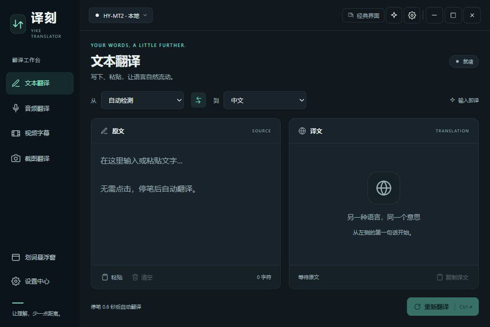
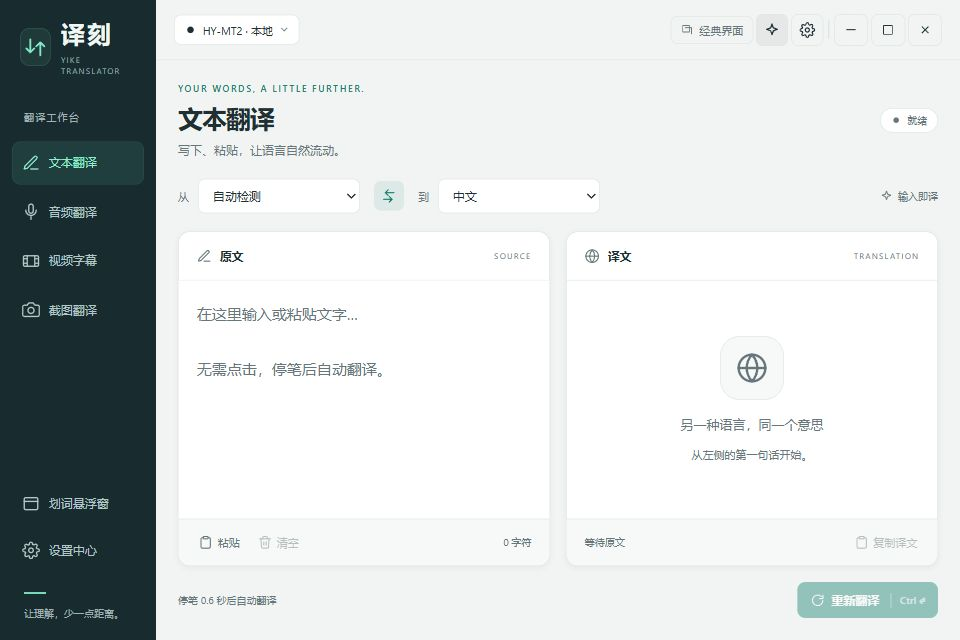

# Previous workbench interface

This page documents the retained `译刻-工作台版.exe` build and its historical visual checks. The new three-style candidate uses different materials/navigation and settings-only style selection; see [connected interface usage and acceptance](INTERFACE_INTEGRATION.md).

The main window defaults to the studio layout: an ink-colored mode rail, a mint accent, a shared language toolbar and separate source/translation panels. Light, dark and system themes remain supported. Custom background, text, font size and accent settings still apply; studio buttons choose black or white text for a custom accent.

## Daily use

- Switch between text, audio, video subtitle and screenshot translation in the left rail. Each mode retains its own translation output.
- Select the translation engine/model in the title bar. Model installation and provider configuration remain under Settings > Models.
- Text translates automatically 600 ms after input changes. **Ctrl+Enter**, or **Translate again**, runs it immediately and clears the pending debounce timer.
- **Paste** reads text through the native clipboard plugin. **Clear** clears text and its translation. **Copy translation** copies the visible output; audio copies the two most recent translated lines. Clipboard success/errors appear in the bottom status area.
- The two panels scroll independently at desktop widths. At 820 CSS pixels or less, the rail collapses to icons and panels stack in the scrolling workspace. Icon controls retain accessible names/tooltips.
- The title-bar theme button switches between light and dark explicitly. Select **System** in Settings > General to resume following the OS.
- Audio states use readable loading/ready/stopped labels. A mode's status describes that mode; running audio does not replace the text translation status.
- Settings > About reads the application version from the Tauri build manifest rather than an outdated hardcoded label.

## Reversible layout

The title-bar **Classic interface** button immediately returns to the original layout. **Workbench interface** switches back. Settings > General > Interface layout offers the same selection. Current input, outputs, engine/model and recognition state are retained because the layouts share the same React state and handlers.

`settings.uiLayout` is an optional configuration-version-3 field. Valid values are `studio` (default) and `classic`; absent/unknown values select `studio`. The preference is restored after asynchronous configuration loading and saved immediately when changed. No model or provider migration is required. Older executables ignore this field and may omit it when resaving configuration.

The new local executable is `E:/TranslatorApp/译刻-工作台版.exe`. The stable repair and original executables are retained separately. For binary/source rollback and the independent Git archive, see [rollback instructions](ROLLBACK.md).

## UI review

| Before | After | Why |
| --- | --- | --- |
| Four large mode cards and a full-width floating toggle precede the editor. | Persistent mode rail with a floating-window shortcut. | More vertical room for text and faster mode switching. |
| Source and translation are vertically separated at normal desktop sizes. | Two aligned panels, with a shared language toolbar for every mode. | Read and compare both languages without scrolling the whole page. |
| Text actions require selection/keyboard operations; empty output is a plain sentence. | Paste, clear, character count, copy feedback and descriptive empty states. | Make the next action apparent and confirm clipboard operations. |
| Navigation replays a slide animation; native audio tokens appear verbatim. | Immediate navigation, readable audio states, theme-aware controls and reduced-motion support. | Keep frequent actions steady and status understandable. |
| Returning to an earlier UI requires changing the executable. | Immediate classic-layout switch plus preserved source/binary checkpoints. | Compare freely and undo the design without losing translation state. |

## Preview and verification

After `npm ci`, run from the source root:

```powershell
npm run ui:preview
```

Open `http://127.0.0.1:1427/__audit`. This serves the actual React/CSS with fixture IPC, models, recognition events, clipboard and translation results. It does not use real APIs, devices, the system clipboard or runtime configuration. Preview preferences are isolated in the browser's `yike-ui-preview-config` local-storage entry. Stop the server with Ctrl+C. This fixture is a visual development aid, not a replacement for `npm run tauri dev` or native smoke testing.

Twenty-five frontend regression tests passed, including classic-layout startup and saved-layout hydration. Browser checks covered all four modes, light/dark themes, settings/model pages, 960×640 and 720×480 sizes, clipboard round-trip/feedback and classic-layout persistence after reload. No horizontal overflow was observed at the tested minimum size. The browser console reported no errors. Eight Rust regression tests and the Tauri release build also passed. Actual device capture, paid API services and the final executable's native window behavior remain unverified.

The redesign adds no UI runtime dependencies. Its production assets are about 326 kB JavaScript (99 kB gzip) and 37 kB CSS (7 kB gzip); the previous repair build used about 317 kB JavaScript and 26 kB CSS.




